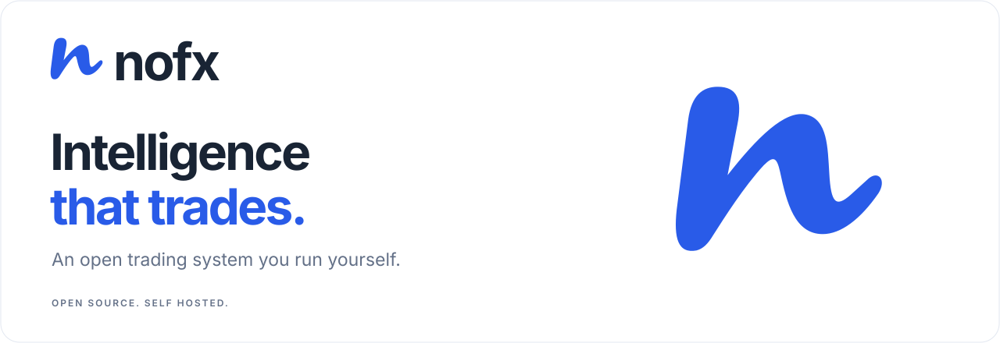
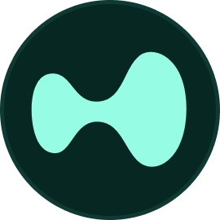
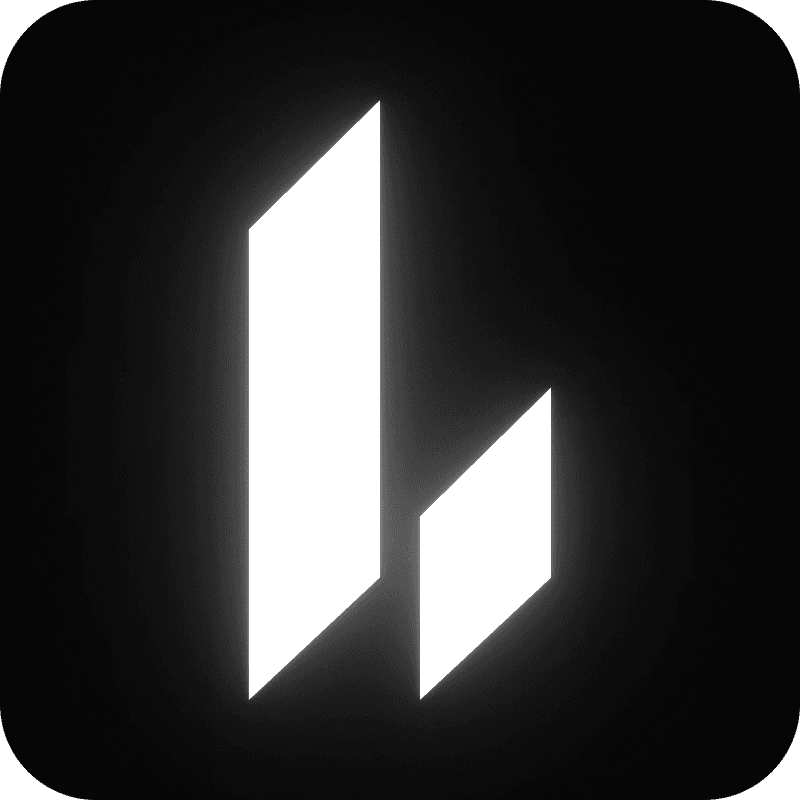

<p align="center">
  
</p>

<p align="center">
  <a href="#frontier">Frontier</a> ·
  <a href="#run-locally">Get started</a> ·
  <a href="#documentation">Documentation</a> ·
  <a href="#community">Community</a>
</p>

<p align="center">
  <a href="https://github.com/NoFxAiOS/nofx/stargazers"></a>
  <a href="LICENSE"></a>
  <a href="https://t.me/nofx_dev_community"></a>
</p>

<p align="center">
  <a href="README.md">English</a> ·
  <a href="docs/i18n/zh-CN/README.md">中文</a> ·
  <a href="docs/i18n/ja/README.md">日本語</a> ·
  <a href="docs/i18n/ko/README.md">한국어</a> ·
  <a href="docs/i18n/ru/README.md">Русский</a> ·
  <a href="docs/i18n/uk/README.md">Українська</a> ·
  <a href="docs/i18n/vi/README.md">Tiếng Việt</a>
</p>

NOFX is an open-source trading system you run on your own machine. Use **Frontier** to work through a trade with AI, compare entries on a chart and approve the order yourself. Use **Autopilot** to run a strategy continuously. Both use your configured models and exchange accounts.

Built with [Vergex](https://vergex.trade). AI and data access through [Claw402](https://claw402.ai).

## Run locally

**One-line install — Linux / macOS**

Install and start Docker with Compose, then run:

```bash
curl -fsSL https://raw.githubusercontent.com/NoFxAiOS/nofx/main/install.sh | bash
```

Open **http://127.0.0.1:3000** in your desktop browser.

The installer generates missing environment keys and starts NOFX using published Docker images. No Go or Node.js setup is needed. Continue with [your first session](#your-first-session), or see [source builds and other options](#source-builds-and-other-options).

## Frontier

A chart, a conversation and a trade you can inspect before placing it.

1. **Choose a market.** Browse top-volume instruments, search native exchange symbols or use the Binance AI500 list. Stock-linked markets appear where supported by the venue.
2. **Compare ways to enter.** Request market, limit, weighted ladder and TWAP plans. See entry prices, stop loss, targets, leverage, position value and estimated margin together.
3. **Review and trade.** Select a plan to focus the chart. Review the current account and order details, then explicitly approve execution.
4. **Manage the position.** Check live positions and exchange orders below the chart, with controls for manual entries and closing positions.

Frontier supports **Binance USDT perpetuals, Hyperliquid, OKX and Bitget**. You can browse public markets before connecting an execution account; trading requires a matching account. Generating a plan does not submit an order.

| Entry | How it works |
| :---- | :----------- |
| **Market** | Enter at the available market price after approval; the displayed entry is an estimate. |
| **Limit** | Submit an entry at a chosen price. |
| **Ladder** | Split the position across weighted price levels. |
| **TWAP** | Release a finite sequence of orders over time, within the approved price limits. |

Limit orders and scheduled slices may remain unfilled. [Execution details and recovery](docs/features/trade-planning.md).

## Autopilot

For strategies you want to run continuously, configure a trader with a model, exchange account and strategy. Autopilot reads the market, makes decisions and routes orders through the NOFX exchange runtime. The Dashboard shows positions, performance and decision history.

**Frontier requires approval for each trade. Autopilot can place trades while it is running.** Starting or stopping Autopilot is a separate action.

| Workspace | What you do there |
| :-------- | :---------------- |
| **Config** | Connect models, fund the AI wallet and manage trading accounts. |
| **Frontier** | Explore markets, compare entry plans and place reviewed orders. |
| **Dashboard** | Follow your running traders, positions and decision history. |
| **Strategy** | Configure market selection, indicators, sizing and trading instructions. |
| **Leaderboard** | Compare published trader performance. |

## Your first session

1. **Create your local account.** Sign in to the instance you just started.
2. **Set up AI in Config.** Choose a model. With Claw402, create or import an AI fee wallet, save its private key and fund its address with **USDC on Base**. This balance pays for model and paid-data requests.
3. **Add a trading account.** Connect the exchange you want to use. Check its account equity and available balance. Trading funds stay separate from your AI fee wallet.
4. **Open Frontier.** Select the exchange, account and market. Generate plans, compare them on the chart and review an order when you are ready.

For continuous trading, configure and start Autopilot separately.

### Updating an installer-based installation

After stopping active Autopilot traders and reviewing any running Frontier execution, run these commands from your installation directory (by default `~/nofx`):

```bash
docker compose pull
docker compose up -d
```

Keep `.env` and the `data/` directory when upgrading; they contain configuration, encryption material and saved application state.

After restarting, check positions and orders at the exchange and reconcile any execution marked as needing attention before placing another trade. Stopping a process does not close its positions.

## Source builds and other options

<details>
<summary>Developers: build and update from source</summary>

Use this option when developing NOFX or testing source changes before published images are updated. Install Git and Docker with Compose, and start Docker:

```bash
git clone --recurse-submodules https://github.com/NoFxAiOS/nofx.git
cd nofx
./start.sh start --build
```

The startup script creates `.env` when needed and generates missing encryption keys. If you cloned without submodules, run `git submodule update --init web/vendor/charting` before building. TradingView chart assets are subject to their applicable license; see [chart integration notes](docs/features/trade-planning.md#harness-chart-and-plugins).

To update a source installation, stop active Autopilot traders and review running Frontier execution, then:

```bash
git pull --ff-only
git submodule update --init web/vendor/charting
./start.sh start --build
```

</details>

<details>
<summary>Windows, Railway and remote deployments</summary>

**Windows**

Use Docker Desktop and a Bash environment such as WSL2, then run the one-line installer above.

**Railway**

[](https://railway.com/deploy/nofx?referralCode=nofx)

**Remote deployments**

The installer uses the production Compose configuration, which publishes its ports on all host interfaces by default. The source Compose configuration binds the frontend and API to `127.0.0.1` by default. Configure host bindings and an authenticated HTTPS proxy before exposing a remote instance.

</details>

<details>
<summary>Development without Docker</summary>

Use the Go version specified in [go.mod](go.mod), Node.js 24 as used by the frontend Docker build, and TA-Lib. Initialize the charting submodule before starting the frontend. Configure the environment using [.env.example](.env.example).

```bash
# Backend
go build -o nofx .
./nofx

# Frontend, in a second terminal
cd web
npm ci
npm run dev
```

</details>

## Models and data

Frontier and Autopilot reuse models configured in NOFX. [Claw402](https://claw402.ai) provides access to multiple models with usage settled in USDC on Base; choose the model in Config and switch it in the workspace.

Exchange prices and candles come from the selected venue. AI500 and supported holder analytics use paid Claw402 routes. Data availability depends on the market and provider: a Hyperliquid holder dataset is not a substitute for Binance, OKX or Bitget data. The activity stream shows data reads and planning progress.

AI fees, paid-data fees and exchange trading funds are separate. Model requests can incur charges even when no trade is placed.

## Exchanges

Frontier currently exposes Binance, Hyperliquid, OKX and Bitget. The broader NOFX runtime also includes Bybit, Gate, KuCoin, Aster and Lighter. Available products, order types and account permissions depend on the exchange.

The links below are partner registration links that support development. Fee offers are set by each exchange.

| Exchange                                                                                                                      | Status | Partner link                                                          |
| :---------------------------------------------------------------------------------------------------------------------------- | :----: | :---------------------------------------------------------------------------------- |
|  **Binance**       |   ✅   | [Register](https://www.binance.com/join?ref=NOFXENG)                                |
|  **Bybit**           |   ✅   | [Register](https://partner.bybit.com/b/83856)                                       |
|  **OKX**               |   ✅   | [Register](https://www.okx.com/join/1865360)                                        |
|  **Hyperliquid** |   ✅   | [Register](https://app.hyperliquid.xyz/join/AITRADING)                              |
|  **Bitget**         |   ✅   | [Register](https://www.bitget.com/referral/register?from=referral&clacCode=c8a43172) |
|  **KuCoin**         |   ✅   | [Register](https://www.kucoin.com/r/broker/CXEV7XKK)                                |
|  **Gate**             |   ✅   | [Register](https://www.gatenode.xyz/share/VQBGUAxY)                                 |
|  **Aster**           |   ✅   | [Register](https://www.asterdex.com/en/referral/fdfc0e)                             |
|  **Lighter**       |   ✅   | [Register](https://app.lighter.xyz/?referral=68151432)                              |

## How execution works

Plans and strategy decisions use the existing NOFX exchange adapters. The model does not receive wallet private keys or exchange credentials in its prompt.

- **Reviewable orders.** Frontier shows account, sizing, entry and exit details before approval. Autopilot follows its configured strategy and runtime limits.
- **Account-aware sizing.** Frontier uses the selected leverage and current available margin, with execution costs reserved. Quantity, tick size and venue limits still apply.
- **Exchange-side exits.** The runtime places supported stop-loss and take-profit orders as fills are observed. Entry and protection are not atomic; inspect the exchange if protection fails.
- **Order reconciliation.** Uncertain submission results are checked against the exchange rather than blindly resubmitted. Unresolved executions can pause further entries.
- **Local configuration.** Exchange credentials are stored encrypted by the NOFX server. Your installation also holds signing material, so protect its files and backups.

## Architecture

```text
Desktop browser
  Frontier · Config · Dashboard · Strategy
                    │
                NOFX API
                    │
       ┌────────────┴────────────┐
  Frontier planning         Autopilot
  Review and approval       Strategy loop
       └────────────┬────────────┘
              Shared execution
              Exchange adapters
                    │
             Your trading accounts

Models and paid data: NOFX provider clients · Claw402
Storage: local configuration, plans and execution records
```

<details>
<summary>Earlier interface walkthrough</summary>

This video shows an earlier version of the interface. Navigation and visual design have since changed.

https://github.com/user-attachments/assets/3310f495-14c5-4586-a1cc-3d32e44aa505

</details>

## Brand assets

- [Logo mark — SVG](web/public/icons/nofx-flow.svg)
- [GitHub avatar — PNG, 512 × 512](web/public/brand/nofx-avatar-512.png)
- [GitHub avatar — SVG source](web/public/brand/nofx-avatar.svg)
- [README banner — SVG](docs/assets/nofx-banner.svg)

## Documentation

| Guide | Contents |
| :---- | :------- |
| [Frontier](docs/features/trade-planning.md) | Planning, live execution, data and recovery |
| [Getting started](docs/getting-started/README.md) | Deployment and exchange API guides |
| [Architecture](docs/architecture/README.md) | System design and module index |
| [Strategy module](docs/architecture/STRATEGY_MODULE.md) | Coin selection, AI prompts and execution |
| [FAQ](docs/guides/faq.en.md) | Common questions |
| [Troubleshooting](docs/guides/TROUBLESHOOTING.md) | Diagnosing common issues |

## Community


[Telegram](https://t.me/nofx_dev_community) · [Twitter/X](https://x.com/vergex_ai) · [Issues](https://github.com/NoFxAiOS/nofx/issues) · [vergex.trade](https://vergex.trade) · [Live dashboard](https://vergex.trade/explore)

## Contributing

Code, documentation, translations, and bug reports are all welcome — see the [Contributing Guide](CONTRIBUTING.md), [Code of Conduct](CODE_OF_CONDUCT.md), and [Security Policy](SECURITY.md).

NOFX tracks meaningful contributions and intends to reward contributors as the ecosystem grows. Priority issues carry higher weight.

| Contribution      | Weight |
| :---------------- | :----: |
| Pinned Issue PRs  | ★★★★★★ |
| Code (Merged PRs) | ★★★★★  |
| Bug Fixes         |  ★★★★  |
| Feature Ideas     |  ★★★   |
| Bug Reports       |   ★★   |
| Documentation     |   ★★   |

<a href="https://github.com/NoFxAiOS/nofx/graphs/contributors">
  
</a>

## Sponsors

<a href="https://github.com/pjl914335852-ux"></a>
<a href="https://github.com/cat9999aaa"></a>
<a href="https://github.com/1733055465"></a>
<a href="https://github.com/kolal2020"></a>
<a href="https://github.com/CyberFFarm"></a>
<a href="https://github.com/vip3001003"></a>
<a href="https://github.com/mrtluh"></a>
<a href="https://github.com/cpcp1117-source"></a>
<a href="https://github.com/match-007"></a>
<a href="https://github.com/leiwuhen1715"></a>
<a href="https://github.com/SHAOXIA1991"></a>

[Become a sponsor](https://github.com/sponsors/NoFxAiOS)

<br/>

If NOFX is useful to you, a star helps other traders find it.

[](https://star-history.dera.page/#NoFxAiOS/nofx&Date)

## License

[AGPL-3.0](LICENSE)

<sub>Automated trading involves substantial risk. AI-driven strategies are experimental and can lose money. Size positions appropriately, understand each venue, and never trade funds you cannot afford to lose. Full [disclaimer](DISCLAIMER.md).</sub>
